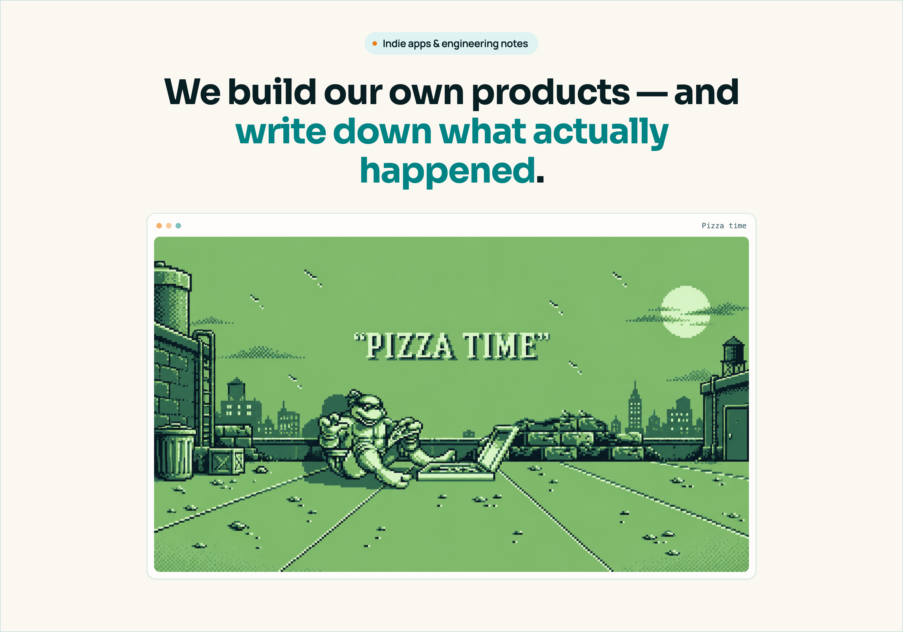

PFP Labs is a California-based product studio. We ship independent apps and publish deep-dive engineering series — real runs, real errors, real code you can clone and run yourself.

<a href="https://pfplabs.ai/blog">Read the blog</a> · <a href="https://pfplabs.ai/#apps">See the apps</a> · <a href="mailto:hello@pfplabs.ai">Say hi</a>

**[Building with TwelveLabs](https://github.com/pfplabs/twelvelabs-video-lab)** — From ChatGPT to Bedrock. Six chapters, one public repo, every result checked against the footage. [Open the series](https://pfplabs.ai/blog/video-ai).

**[Gwhen](https://www.gwhen.app)** — Reads the forecast and answers one question: when should I go?

**[tinymissions](https://www.tinymissions.app)** — From "we should do something" to play in seconds.

**[mntn passport](https://pfplabs.ai/blog/mntn-passport-mountain-passport-for-hikers)** — A living record of every mountain you climb. Coming soon.
